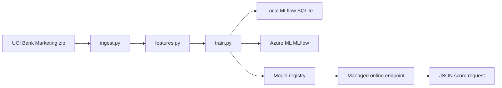

# Bank term-deposit predictor

A small production-style machine learning project. A bank called 45,211 people and asked them to open a term deposit. This project predicts the chance that the next person will say yes, tracks the experiments in Azure Machine Learning, and serves the winning model from a managed online endpoint.

It is a teaching project. The data is public. The customers are real historical rows from a research dataset, not your bank.

## The one-sentence story

We refuse the column that would make the model look brilliant (`duration`, the length of a call that has not happened yet), compare three model types, pick the winner on practice data only, and put that winner behind a URL.

## How the pieces connect

```
  You
   |
   |  python main.py train
   v
 +------------------+     download      +---------------------------+
 | main.py          | ----------------> | ingest.py                 |
 | the front door   |                   | UCI zip -> bank-full.csv  |
 +------------------+                   +---------------------------+
   |                                              |
   | train                                        | table of calls
   v                                              v
 +------------------+     prepare columns   +---------------------------+
 | train.py         | --------------------> | features.py               |
 | 3 models, MLflow |                       | drop duration, fix -1     |
 +------------------+                       +---------------------------+
   |                                              ^
   | save winner                                  | same function
   v                                              |
 +------------------+     score one row     +---------------------------+
 | models/          | <-------------------- | predict.py                |
 | pipeline.joblib  |                       | also used by the endpoint |
 +------------------+                       +---------------------------+
   |
   | python main.py deploy
   v
 +------------------+     HTTPS             +---------------------------+
 | Azure ML         | ------------------>   | scoring/score.py          |
 | registry +       |                       | init() once, run() each   |
 | online endpoint  |                       | request                   |
 +------------------+                       +---------------------------+
```

`evaluate.py` only computes scores. `config.py` holds the shared names so those files cannot drift apart. `azure_ml.py` is the only file that talks to Azure. Tests import the same scoring function the endpoint uses.



## Results

Trained on 36,168 rows, graded once on 9,043 held-out rows. About 11.7% of people subscribed. A model that always says "no" would be about 88.3% accurate and would find nobody. Accuracy is the wrong trophy.

The winner was chosen by **cross-validated average precision** on the training rows only. Test numbers are the final exam. They did not vote.

| Model | CV average precision | Test average precision | Test ROC-AUC | Test F1 | Test precision | Test recall | Test accuracy |
| --- | ---: | ---: | ---: | ---: | ---: | ---: | ---: |
| logistic_regression | 0.398 | 0.409 | 0.772 | 0.375 | 0.268 | 0.627 | 0.756 |
| random_forest | 0.426 | 0.437 | 0.793 | 0.436 | 0.347 | 0.587 | 0.822 |
| gradient_boosting (selected) | 0.428 | 0.455 | 0.789 | 0.434 | 0.335 | 0.616 | 0.812 |

Gradient boosting won by a small margin over the random forest (0.428 vs 0.426 on the practice score). On the exam it ranks "yes" rows better (average precision 0.455) and finds about 62% of the subscribers, at the cost of many false alarms (precision 0.335). That tradeoff is what `class_weight="balanced"` does. The endpoint returns the probability so a caller can raise the cutoff.

A sample customer, with a fake call length of 999 seconds in the request, scored **0.4229** and was not flagged. The call length was ignored. That is the leakage rule working.

Full table, written by the trainer: [reports/results.md](reports/results.md).

## Cost notes

Prices below are Linux pay-as-you-go in East US from the Azure Retail Prices API (meter "F2s v2", effective 2025-10-01). They are retail list prices, not a quote for this subscription.

| What | When it costs money | List price |
| --- | --- | --- |
| Training | On your laptop | $0 of Azure compute |
| Workspace, storage, key vault, Application Insights | While the resource group exists | Usually a few dollars a month if idle. Not the bill to watch. |
| Managed online endpoint, `Standard_F2s_v2`, 1 instance | Every hour the endpoint exists, even with zero requests | **$0.0846 per hour**, about **$2.03 per day**, about **$62 per month** |

The endpoint does not scale to zero. Delete it when you are done reviewing:

```powershell
python main.py teardown
```

That deletes the endpoint and its virtual machine. The workspace remains. To delete the workspace and the storage account too:

```powershell
az group delete --name rg-bank-deposit-ml --yes
```

If deployment had to fall back to a larger size, `reports/endpoint.json` names the size that actually ran. `Standard_DS2_v2` and `Standard_DS3_v2` cost more. Check that file before you leave the endpoint up.

## Run it on Windows

PowerShell, from this folder:

```powershell
python -m venv venv
.\venv\Scripts\Activate.ps1
pip install -r requirements.txt -r requirements-dev.txt
copy .env.example .env
python main.py download
python main.py train
python main.py predict
```

Azure tracking and deployment also need:

```powershell
pip install -r requirements-azure.txt
az login
python main.py train --azure
python main.py deploy
python main.py invoke
```

Tests and lint, the same commands GitHub Actions runs:

```powershell
ruff check .
pytest
```

The notebook is [notebooks/01_explore_the_data.ipynb](notebooks/01_explore_the_data.ipynb). It is the look-around step. It does not train the model.

## What each file is for

| File | Job |
| --- | --- |
| [main.py](main.py) | The front door. You run this. |
| [config.py](config.py) | Shared names and the columns we refuse. |
| [ingest.py](ingest.py) | Download the public zip and load the CSV. |
| [features.py](features.py) | Drop leakage, fix the `-1` code, build the sklearn assembly line. |
| [train.py](train.py) | Fit three models, log them, save the winner. |
| [evaluate.py](evaluate.py) | The scores, including the ones accuracy hides. |
| [predict.py](predict.py) | Score customers. The endpoint calls this too. |
| [scoring/score.py](scoring/score.py) | The two function names Azure requires: `init` and `run`. |
| [azure_ml.py](azure_ml.py) | Registry, endpoint, invoke, teardown. |
| [DECISIONS.md](DECISIONS.md) | Why this way, and what was rejected. |
| [LEARNING_GUIDE.md](LEARNING_GUIDE.md) | A 45-minute review so you can explain it. |

## Dataset

Moro, S., Rita, P., and Cortez, P. (2012). Bank Marketing. UCI Machine Learning Repository. https://doi.org/10.24432/C5K306

License: CC BY 4.0. The file used is `bank-full.csv` inside the nested zip at <https://archive.ics.uci.edu/dataset/222/bank+marketing>.

## If the laptop cannot upload the model

This subscription creates storage accounts with public network access disabled, and it ignores attempts to turn that access back on. `python main.py deploy` from the laptop then fails, first with a key-auth error, then with `AuthorizationFailure`. That is decision 15.

The path that works is a managed virtual network (a private door from Azure ML compute to storage) and a job that does not upload a local folder:

```powershell
az ml workspace update --name mlw-bank-deposit --resource-group rg-bank-deposit-ml --managed-network allow_internet_outbound
az ml workspace provision-network --name mlw-bank-deposit --resource-group rg-bank-deposit-ml
az ml job create --file azure/train_job.yml --resource-group rg-bank-deposit-ml --workspace-name mlw-bank-deposit
```

The job downloads this repository from GitHub, trains, registers, and deploys. Your laptop only sends the job request.
